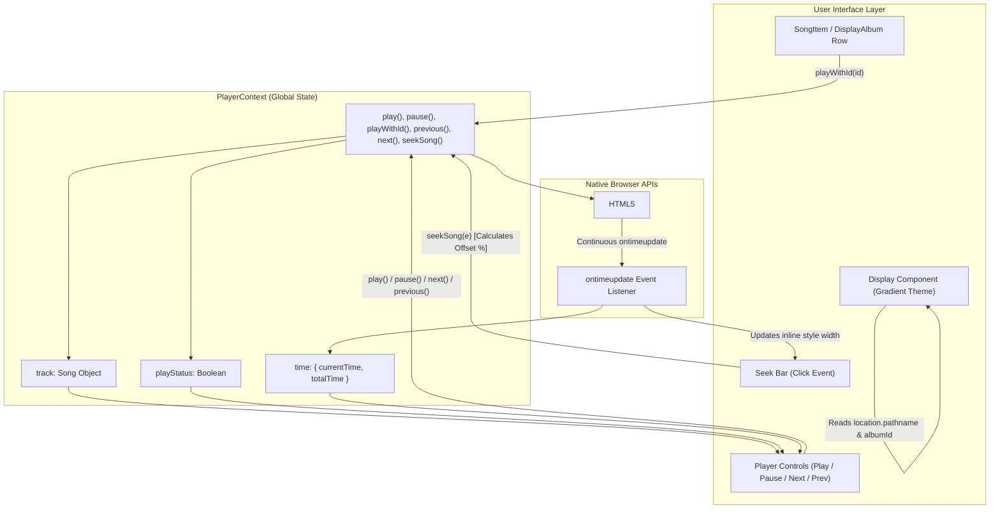
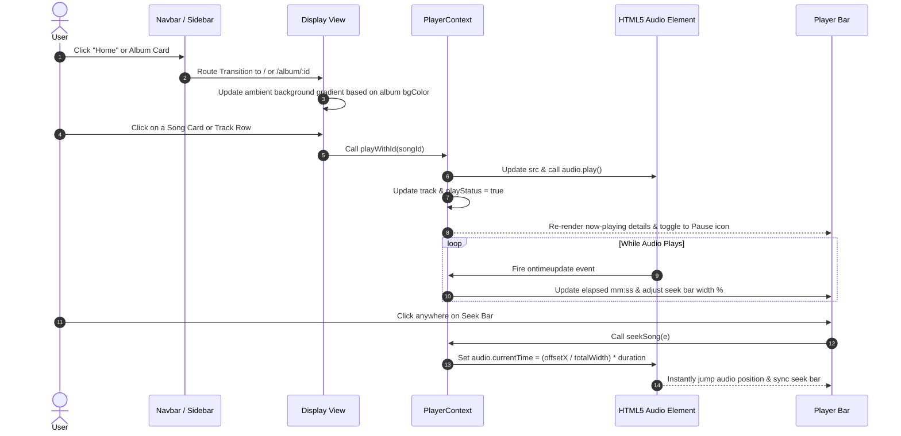

# 🎵 Spotify Clone Frontend

<p align="center">
  
</p>

<p align="center">
  <strong>A modern, responsive, high-fidelity Spotify Web Player clone built with React 19, Vite, Tailwind CSS, and React Router v7.</strong>
</p>

<p align="center">
  <a href="https://react.dev/"></a>
  <a href="https://vite.dev/"></a>
  <a href="https://tailwindcss.com/"></a>
  <a href="https://reactrouter.com/"></a>
  <a href="https://oxc.rs/"></a>
  
</p>

---

## 📑 Table of Contents

- [Project Overview](#-project-overview)
  - [Problem Statement](#problem-statement)
  - [Proposed Solution](#proposed-solution)
  - [Core Objectives](#core-objectives)
  - [Real-World Applications](#real-world-applications)
- [Key Features](#-key-features)
- [Technology Stack](#-technology-stack)
- [System Architecture](#-system-architecture)
  - [Component Hierarchy](#component-hierarchy)
  - [Audio Playback & State Data Flow](#audio-playback--state-data-flow)
- [Project Folder Structure](#-project-folder-structure)
- [Prerequisites](#-prerequisites)
- [Installation and Setup](#-installation-and-setup)
- [Environment Variables](#-environment-variables)
- [Database Configuration & Data Models](#-database-configuration--data-models)
- [API & Route Documentation](#-api--route-documentation)
  - [Application Routes](#application-routes)
  - [Player Context API Contract](#player-context-api-contract)
- [Application Workflow](#-application-workflow)
- [Screenshots & Visual Tour](#-screenshots--visual-tour)
- [Future Enhancements](#-future-enhancements)
- [Contributors](#-contributors)
- [License](#-license)

---

## 🌟 Project Overview

### Problem Statement
Standard web-based audio streaming interfaces often suffer from clunky state synchronization between playback controls, tracklists, and seek mechanisms. Replicating the seamless, immersive user experience of modern digital media platforms like Spotify requires cohesive synchronization of native HTML5 audio events, responsive dual-pane navigation, and real-time contextual UI themes without introducing heavy, over-engineered state management libraries.

### Proposed Solution
This **Spotify Clone Frontend** is an ultra-fast, lightweight Single Page Application (SPA) designed to emulate the signature look, feel, and functionality of Spotify's Web Player. Powered by **React 19** and **Vite 8**, it leverages the native React Context API (`PlayerContext`) for centralized audio playback orchestration, Tailwind CSS for Spotify's signature dark-mode aesthetic, and React Router v7 for dynamic client-side route transitions and ambient gradient theming.

### Core Objectives
- **Authentic UX/UI Reproduction:** Emulate Spotify's desktop and mobile layouts, including sidebar navigation, featured carousels, album track tables, and persistent bottom media transport controls.
- **Accurate Audio Synchronization:** Connect native `<audio>` element events with React state to deliver precise time elapsed/remaining readouts and scrubbable progress tracking.
- **Dynamic Ambient Styling:** Adapt the application's background gradient automatically based on the dominant theme color of the currently selected album.
- **High Performance & Developer Ergonomics:** Achieve sub-second hot reloading and instant bundle compilation via Vite and Rust-powered Oxlint.

### Real-World Applications
- **Media & Entertainment Frontends:** Reference architecture for building custom web-based audio streaming clients, podcast dashboards, or audio portfolio players.
- **State Management Case Study:** Practical demonstration of managing audio element lifecycle events using `useRef`, `useContext`, and `useEffect` without external dependencies.
- **UI/UX Showcase:** Production-grade template for dark-mode streaming interfaces with dynamic color theming.

---

## ⚡ Key Features

| Category | Implemented Feature | Description |
| :--- | :--- | :--- |
| 🎧 **Audio Playback Engine** | **Global Play / Pause Toggle** | Seamless audio playback management via `PlayerContext` with real-time icon state toggling. |
| | **Track Navigation** | Skip to next or previous tracks sequentially with automatic boundary checks across the song collection. |
| | **Direct Track Selection** | Click any song card from the Home view or any row within an album tracklist to immediately switch and play the track. |
| 🎚️ **Interactive Seek Bar** | **Real-Time Progress Tracking** | Continuous updates to the seek bar width driven by native `ontimeupdate` events. |
| | **Scrubbable Time Control** | Click anywhere along the seek track to seek to that relative timestamp dynamically. |
| | **Dual Time Counters** | Real-time formatted display of current playback time (`mm:ss`) alongside total audio duration. |
| 🎨 **Dynamic Ambient Theming** | **Contextual Color Gradients** | When entering an album view (`/album/:id`), the main viewport background transitions dynamically into a gradient matching the album's accent color (`#2a4365`, `#22543d`, `#742a2a`, `#44337a`, etc.), falling back to `#121212` on the home view. |
| 🧭 **Navigation & Routing** | **Client-Side SPA Routing** | Powered by React Router DOM v7 with support for deep linking to individual albums (`/album/:id`). |
| | **Browser History Controls** | Dedicated Back (`navigate(-1)`) and Forward (`navigate(1)`) buttons in the top navigation bar. |
| 📱 **Responsive UI Layout** | **Collapsible Sidebar** | Full-featured sidebar on large screens (`hidden lg:flex`) with Home, Search, and Library action cards. |
| | **Horizontal Scroll Carousels** | Responsive carousel containers for *Featured Albums* and *Today's Hits* with hidden scrollbars for a clean look. |
| | **Sticky Bottom Media Bar** | Fixed-bottom player showcasing current track thumbnail, title, artist note, transport controls, and auxiliary utility icons. |

---

## 🛠️ Technology Stack

### Frontend Core & Libraries
| Technology | Version | Purpose |
| :--- | :--- | :--- |
| **[React](https://react.dev/)** | `^19.3.1` | Modern declarative UI library utilizing React 19 functional components and hooks. |
| **[ReactDOM](https://react.dev/)** | `^19.3.1` | Package providing DOM-specific methods for rendering React root nodes. |
| **[React Router DOM](https://reactrouter.com/)** | `^7.18.5` | Declarative client-side routing, route parameters (`useParams`), and history navigation (`useNavigate`). |

### Build Tools & Tooling
| Technology | Version | Purpose |
| :--- | :--- | :--- |
| **[Vite](https://vite.dev/)** | `^8.3.5` | Next-generation frontend bundler providing instant Hot Module Replacement (HMR) and optimized Rollup builds. |
| **[@vitejs/plugin-react](https://github.com/vitejs/vite-plugin-react)** | `^6.1.2` | Official Vite plugin for React support using Babel/Oxc fast compilation. |
| **[Tailwind CSS](https://tailwindcss.com/)** | `^3.4.19` | Utility-first CSS framework for layout styling, dark mode design, and responsive utilities. |
| **[PostCSS](https://postcss.org/)** | `^8.5.32` | Tool for transforming styles with JS plugins. |
| **[Autoprefixer](https://github.com/postcss/autoprefixer)** | `^10.6.2` | PostCSS plugin to parse CSS and add vendor prefixes automatically. |
| **[Oxlint](https://oxc.rs/)** | `^1.89.0` | Ultra-fast Rust-based JavaScript and React linter configured for React hook rules. |

### Media & Assets
- **Audio Engine:** HTML5 Audio API via native `<audio>` element controlled through React `useRef`.
- **Media Formats:** Bundled `.mp3` audio files and `.jpg` / `.png` / `.svg` visual assets.

---

## 🏗️ System Architecture

### Component Hierarchy

```
main.jsx
└── StrictMode
    └── BrowserRouter
        └── PlayerContextProvider (PlayerContext.jsx)
            └── App.jsx
                ├── <audio ref={audioRef} src={track.file} preload="auto" />
                ├── Sidebar.jsx (Home, Search, Your Library, Action Cards)
                ├── Display.jsx (Dynamic Gradient Controller & Route Outlet)
                │   └── Routes
                │       ├── Route "/" ───────> DisplayHome.jsx
                │       │                      ├── Navbar.jsx (History controls, filters)
                │       │                      ├── AlbumItem.jsx (Featured Albums carousel)
                │       │                      └── SongItem.jsx (Today's Hits carousel)
                │       │
                │       └── Route "/album/:id" > DisplayAlbum.jsx
                │                              ├── Navbar.jsx
                │                              ├── Album Header & Stats
                │                              └── Album Tracklist Table (Playable rows)
                │
                └── Player.jsx (Now Playing Info, Transport Controls, Seek Bar, Volume/Aux Icons)
```

### Architectural Data Flow & State Management



---

## 📁 Project Folder Structure

```text
spotify-clone-frontend/
├── public/                         # Public static assets
│   ├── favicon.svg                 # Application favicon
│   └── icons.svg                   # SVG icon sprite sheet
├── src/                            # Application source code
│   ├── assets/                     # Media files, icons, and mock datasets
│   │   ├── arrow.png               # Sidebar library arrow icon
│   │   ├── assets.js               # Central asset registry & mock albums/songs datasets
│   │   ├── bell.png                # Notification bell icon
│   │   ├── clock_icon.png          # Tracklist duration header clock icon
│   │   ├── hero.png                # Hero promotional graphic
│   │   ├── home.png                # Sidebar Home navigation icon
│   │   ├── img1.jpg - img16.jpg    # High-resolution album and track artwork
│   │   ├── left_arrow.png          # Navbar back history arrow
│   │   ├── right_arrow.png         # Navbar forward history arrow
│   │   ├── like.png                # Track favorite/like icon
│   │   ├── loop.png                # Repeat/loop playback icon
│   │   ├── mic.png                 # Lyrics/microphone icon
│   │   ├── mini-player.png         # Picture-in-picture mini-player icon
│   │   ├── next.png                # Skip to next track icon
│   │   ├── pause.png               # Audio pause icon
│   │   ├── play.png                # Audio play icon
│   │   ├── plays.png               # Plays count icon
│   │   ├── plus.png                # Add playlist icon
│   │   ├── prev.png                # Skip to previous track icon
│   │   ├── queue.png               # Playback queue icon
│   │   ├── react.svg               # React official logo
│   │   ├── search.png              # Sidebar search icon
│   │   ├── shuffle.png             # Shuffle playback icon
│   │   ├── song1.mp3 - song3.mp3   # Bundled sample audio files
│   │   ├── speaker.png             # Output device icon
│   │   ├── spotify_logo.png        # Official Spotify badge logo
│   │   ├── stack.png               # Library stack icon
│   │   ├── vite.svg                # Vite logo
│   │   ├── volume.png              # Speaker volume icon
│   │   └── zoom.png                # Fullscreen zoom icon
│   ├── components/                 # Reusable React UI components
│   │   ├── AlbumItem.jsx           # Card for browsing featured albums
│   │   ├── Display.jsx             # Main viewport container with dynamic gradient logic
│   │   ├── DisplayAlbum.jsx        # Detailed album playlist view and tracklist table
│   │   ├── DisplayHome.jsx         # Homepage view displaying album and song rows
│   │   ├── Navbar.jsx              # Top app bar with history navigation & filter chips
│   │   ├── Player.jsx              # Sticky bottom playback controller bar
│   │   ├── Sidebar.jsx             # Left desktop navigation panel
│   │   └── SongItem.jsx            # Card for individual songs in carousels
│   ├── context/                    # React Context providers
│   │   └── PlayerContext.jsx       # Centralized audio playback state and control methods
│   ├── App.jsx                     # Root application component uniting layout & audio element
│   ├── index.css                   # Global stylesheet with Tailwind directives & scrollbar reset
│   └── main.jsx                    # Application entry point with BrowserRouter & StrictMode
├── .gitignore                      # Git ignored files (node_modules, dist, logs)
├── .oxlintrc.json                  # Oxlint configuration for React hooks and components
├── index.html                      # HTML5 template mount point
├── package.json                    # Project manifest, scripts, and dependencies
├── package-lock.json               # Locked dependency tree
├── postcss.config.js               # PostCSS plugin pipeline (Tailwind CSS, Autoprefixer)
├── tailwind.config.js              # Tailwind utility configuration & content scanning paths
├── vite.config.js                  # Vite build tool and plugin configuration
└── README.md                       # Comprehensive project documentation
```

### Notable Code Modules

- **[`src/context/PlayerContext.jsx`](file:///src/context/PlayerContext.jsx):** The core engine of the app. Houses the React `useRef` handles for `<audio>`, `seekBar`, and `seekBg`, as well as state for `track`, `playStatus`, and formatted `time`.
- **[`src/components/Display.jsx`](file:///src/components/Display.jsx):** Inspects the active URL using `useLocation()`. If the route matches `/album/:id`, it extracts the album ID, reads its assigned `bgColor`, and applies an inline CSS linear gradient to simulate ambient light.
- **[`src/assets/assets.js`](file:///src/assets/assets.js):** Provides a centralized export for all media assets alongside mock datasets `albumsData` and `songsData`.

---

## 📋 Prerequisites

Before setting up the project locally, ensure you have the following installed:

- **Node.js:** `v18.x` or higher (`v20.x` or `v22.x` recommended).
  ```bash
  node --version
  ```
- **Package Manager:** `npm` (comes with Node.js, `v9.x`+), `yarn`, `pnpm`, or `bun`.
  ```bash
  npm --version
  ```
- **Modern Web Browser:** Google Chrome, Mozilla Firefox, Microsoft Edge, Brave, or Apple Safari with HTML5 Audio capabilities enabled.

---

## 🚀 Installation and Setup

Follow these step-by-step instructions to get the application running locally:

### 1. Clone the Repository
```bash
git clone https://github.com/Nakshatra2410/spotify-clone-frontend.git
cd spotify-clone-frontend
```

### 2. Install Project Dependencies
Install all required production and development dependencies via `npm`:
```bash
npm install
```

### 3. Start the Development Server
Launch Vite's development server with instant Hot Module Replacement (HMR):
```bash
npm run dev
```

The application will start locally. Open your browser and navigate to:
```text
http://localhost:5173
```

### 4. Build for Production
To generate an optimized, minified production build inside the `dist/` directory:
```bash
npm run build
```

### 5. Preview Production Build
Test and inspect the compiled production build locally:
```bash
npm run preview
```

### 6. Run Code Quality Checks
Run Oxlint to check for linting errors across JavaScript and React JSX files:
```bash
npm run lint
```

---

## 🔐 Environment Variables

> [!NOTE]
> The current version of this application operates entirely as a client-side single page application with embedded audio files and mock datasets. **No environment variables are required to run the application locally out of the box.**

If you intend to integrate with a custom backend or the Spotify Web API in the future, you can configure an `.env` file in the root directory:

```bash
# Example .env configuration (for future backend or API integration)
VITE_API_BASE_URL="http://localhost:5000/api"
VITE_SPOTIFY_CLIENT_ID="your_spotify_client_id_here"
```

> [!CAUTION]
> Never commit real `.env` files containing production secrets, API tokens, or client credentials to Git. Always ensure `.env` and `.env.local` are listed in your `.gitignore` file.

---

## 🗄️ Database Configuration & Data Models

In this frontend repository, data is managed via structured JavaScript objects defined in [`src/assets/assets.js`](file:///src/assets/assets.js). This simulates a database response structure and makes future API integration straightforward.

### Data Schemas

#### 1. Album Entity (`albumsData`)
Represents curated music collections and playlists displayed on the home page and individual album views.

```typescript
interface Album {
  id: number;          // Unique identifier (0 to 5)
  name: string;        // Album or playlist title (e.g., "Top 50 Global")
  image: string;       // Imported asset path to cover artwork
  desc: string;        // Short descriptive tagline
  bgColor: string;     // Hex color code used for dynamic ambient gradient
}
```

*Sample Data Record:*
```javascript
{
  id: 0,
  name: "Top 50 Global",
  image: img8,
  desc: "Your weekly update of the most played tracks",
  bgColor: "#2a4365"
}
```

#### 2. Song Entity (`songsData`)
Represents individual audio tracks playable within the application.

```typescript
interface Song {
  id: number;          // Unique numeric identifier (0 to 7)
  name: string;        // Track title (e.g., "Song One")
  image: string;       // Imported asset path to thumbnail artwork
  file: string;        // Imported audio file asset (e.g., song1.mp3)
  desc: string;        // Track subtitle or mood description
  duration: string;    // Formatted track length (e.g., "3:00")
}
```

*Sample Data Record:*
```javascript
{
  id: 0,
  name: "Song One",
  image: img1,
  file: song1,
  desc: "Put a smile on your face with these happy tunes",
  duration: "3:00"
}
```

---

## 📡 API & Route Documentation

### Application Routes

The application utilizes **React Router DOM v7** to manage client-side transitions:

| Route Path | Component View | Description | Key URL Parameters |
| :--- | :--- | :--- | :--- |
| `/` | `DisplayHome` | Default landing view rendering the top navbar, Featured Albums carousel, and Today's Hits carousel. | *None* |
| `/album/:id` | `DisplayAlbum` | Detailed album playlist screen showing album artwork, creator stats, description, and interactive tracklist table. | `:id` - Numeric ID of the album (e.g. `0`, `1`, `2`) |

### Player Context API Contract

Components interact with the audio subsystem through the `PlayerContext` hook (`useContext(PlayerContext)`).

#### Exposed State Properties
| Property | Type | Description |
| :--- | :--- | :--- |
| `track` | `Object` | The currently loaded song object (`id`, `name`, `image`, `file`, `desc`, `duration`). |
| `playStatus` | `Boolean` | `true` if audio is currently playing; `false` if paused. |
| `time` | `Object` | Object tracking `{ currentTime: { second, minute }, totalTime: { second, minute } }`. |
| `audioRef` | `React.RefObject` | Direct reference to the native `<audio>` element rendered in `App.jsx`. |
| `seekBar` | `React.RefObject` | Direct reference to the green active progress `<hr>` element. |
| `seekBg` | `React.RefObject` | Direct reference to the full-width background container `<div>` of the seek bar. |

#### Exposed Methods
| Method | Arguments | Return Type | Description |
| :--- | :--- | :--- | :--- |
| `play()` | *None* | `void` | Resumes playback of the current track and sets `playStatus` to `true`. |
| `pause()` | *None* | `void` | Pauses audio playback and sets `playStatus` to `false`. |
| `playWithId(id)` | `id: number` | `Promise<void>` | Sets `track` to `songsData[id]`, loads audio source, and initiates playback immediately. |
| `previous()` | *None* | `Promise<void>` | Decrements `track.id` if greater than `0` and plays the preceding track. |
| `next()` | *None* | `Promise<void>` | Increments `track.id` if less than `songsData.length - 1` and plays the succeeding track. |
| `seekSong(e)` | `e: MouseEvent` | `Promise<void>` | Computes click offset percentage relative to `seekBg` width and updates `audioRef.current.currentTime`. |

---

## 🔄 Application Workflow

Here is how a user interacts with the application and how events propagate through the system:



---

## 📸 Screenshots & Visual Tour

> [!NOTE]
> Add application screenshots to your repository under an `assets/` or `screenshots/` directory and update the links below to showcase the live UI.

| Desktop Home View | Album Playlist View |
| :---: | :---: |
|  |  |
| *Featured Albums, Today's Hits, and Sidebar navigation* | *Album metadata, ambient theme, and interactive tracklist* |

| Bottom Audio Player & Seek Controls | Responsive Mobile / Tablet Layout |
| :---: | :---: |
|  |  |
| *Synchronized track progress, scrub bar, and volume controls* | *Adaptive layout hiding sidebar on small screens* |

---

## 🔮 Future Enhancements

The following roadmap outlines potential features and technical improvements separated from the currently implemented codebase:

- [ ] **Full-Stack REST / GraphQL API:** Replace local mock assets with a Node.js/Express or Python/FastAPI backend backed by PostgreSQL or MongoDB.
- [ ] **Cloud Streaming Storage:** Host audio tracks and album art on AWS S3 or Cloudinary with adaptive bitrate streaming (HLS/DASH).
- [ ] **Real Spotify API Integration:** Add OAuth 2.0 PKCE authentication allowing users to log into their real Spotify accounts and browse personal playlists.
- [ ] **Interactive Volume Controls:** Implement a functional volume slider and mute/unmute toggle.
- [ ] **Shuffle & Repeat Logic:** Support random track shuffling and single-track repeat / queue repeat modes.
- [ ] **Dynamic Live Search:** Implement real-time client-side search filtering across album titles, track names, and artist tags.
- [ ] **Custom Playlist Creation:** Enable users to create, rename, and add tracks to custom playlists with persistence via `localStorage` or `IndexedDB`.
- [ ] **Synchronized Lyrics:** Implement a synchronized lyrics viewer panel using timestamped `.lrc` data.

---

## 👥 Contributors

This project is actively developed and maintained by:

- **Nakshatra** – [@Nakshatra2410](https://github.com/Nakshatra2410)

Contributions, issues, and feature requests are welcome! Feel free to check the [issues page](https://github.com/Nakshatra2410/spotify-clone-frontend/issues).

---

## 📄 License

This project currently does not have an explicit open-source license file specified in the repository. All rights are reserved by the original author. It is intended for educational, personal demonstration, and portfolio evaluation purposes.

---

<p align="center">
  Built with ❤️ using <strong>React 19</strong>, <strong>Vite</strong>, and <strong>Tailwind CSS</strong>.
</p>
